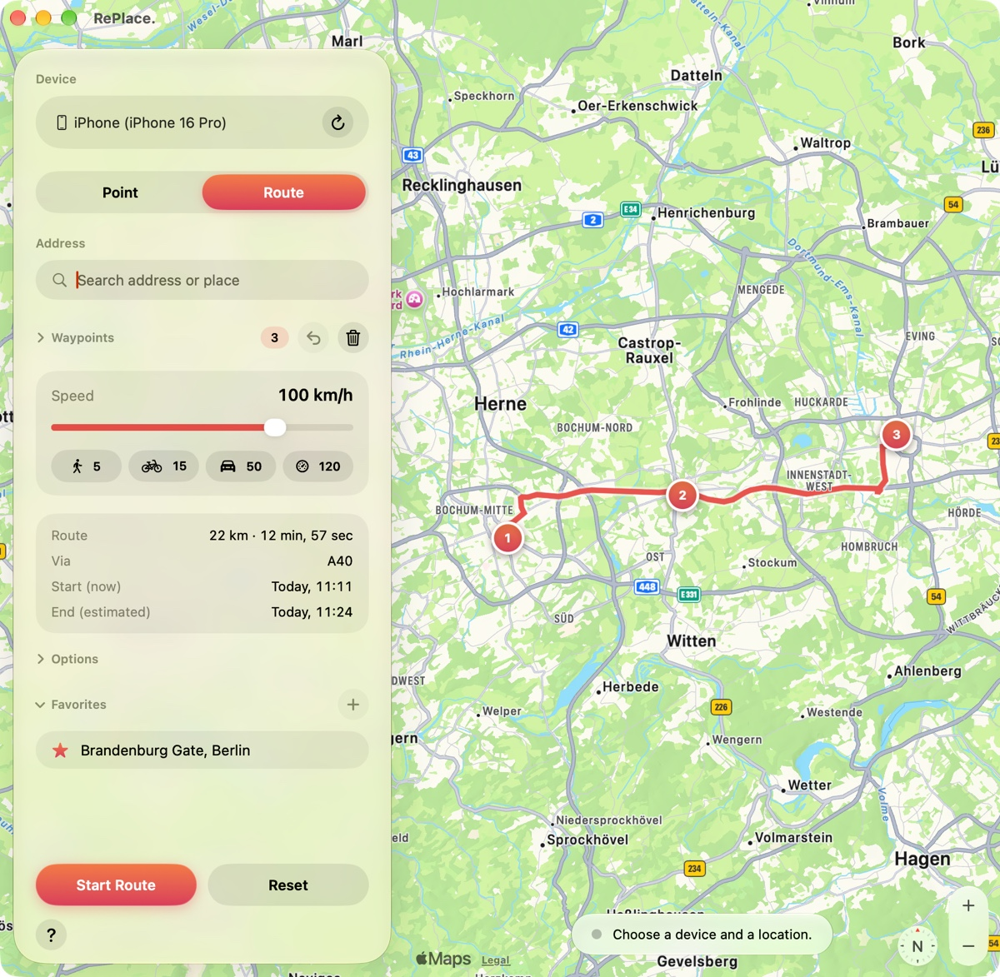

  <picture>
    <source media="(prefers-color-scheme: dark)" srcset="docs/icon-dark.png">
    
  </picture>

# RePlace.

A small macOS app that sets a simulated GPS location, or a moving route, on your iPhone. Pick a place on the map, search an address or paste coordinates. It works for the whole device, so every app sees it. Available in English and German.

  <picture>
    <source media="(prefers-color-scheme: dark)" srcset="docs/screenshot-dark.jpg">
    
  </picture>

## Download

Get the latest build from the [Releases page](https://github.com/timoschrdr/RePlace/releases/latest) (Apple silicon, macOS 27). The app is not notarized, so macOS blocks it on the first launch: open **System Settings → Privacy & Security** and click **Open Anyway**, or run `xattr -dr com.apple.quarantine /Applications/RePlace..app` once. Or build it yourself (below).

## Requirements

- macOS 27 and Xcode (RePlace. uses Apple's `devicectl`, the tool behind Xcode's "Simulate Location"; no jailbreak, no third-party tools)
- An iPhone that is connected, unlocked and paired, with **Developer Mode** turned on (Settings → Privacy & Security)

## Build

Open `RePlace.xcodeproj` in Xcode, choose **My Mac** and press ⌘R. It is signed locally, so no Apple Developer account is needed. To ship your own build, change the bundle identifier (`de.timoschroeder.RePlace`).

## Usage

**Point:** choose your iPhone, click the map, search an address or enter `latitude, longitude`, then press **Set Location**. The sidebar shows when it was set. **Reset** brings back the real location; the simulation also ends when the connection is lost.

**Route:** switch to **Route** and click the map (or pick a place) to add waypoints. Drag a pin to move it, undo with ⌥⌘Z. Choose a speed, then **Start Route**. The iPhone moves along the route and stops at the last waypoint. **Pause** and **Continue** work at any time, even with a different speed. The sidebar shows the estimated end time, which becomes the real arrival time.

**Options** (folded away by default): **Follow roads** routes the whole trip from first to last waypoint with Apple Maps, so longer drives use the motorway, and waypoints only count where the route would otherwise miss them. **Prefer motorways** (from 20 km/h) takes a motorway route when one exists, even if a route through town is a little faster. A route can only join a motorway at its ramps, so for short trips click near an on-ramp and an exit. With **Follow roads** off, the path is a straight line through your clicks.

**Shortcuts:** ⌘↩ main button, ⌘R reset, ⌥⌘Z undo last waypoint. **Settings** (⌘,) lets you pick another app icon for the Dock.

## Privacy

RePlace. collects nothing and has no accounts, analytics or tracking. The map, address search and road routing come from Apple Maps, so search text and, with **Follow roads** on, waypoint coordinates are sent to Apple ([privacy policy](https://www.apple.com/legal/privacy/)). Coordinates reach only the iPhone you select, through `devicectl`. Favorites, the chosen icon and the time of the last location are stored locally in the app's preferences.

## Responsible use

Use RePlace. only on your own devices, for development, testing and privacy purposes. Many apps and services forbid faking your location and may suspend accounts that do so. You are responsible for how you use it. The software is provided as is, without warranty.

## Credits

The raccoon artwork was generated with ChatGPT (OpenAI) and then cut out and cropped. The pin icon and the rest were created for this project.

## License

MIT, see [LICENSE](LICENSE). Security issues: see [SECURITY.md](SECURITY.md).
