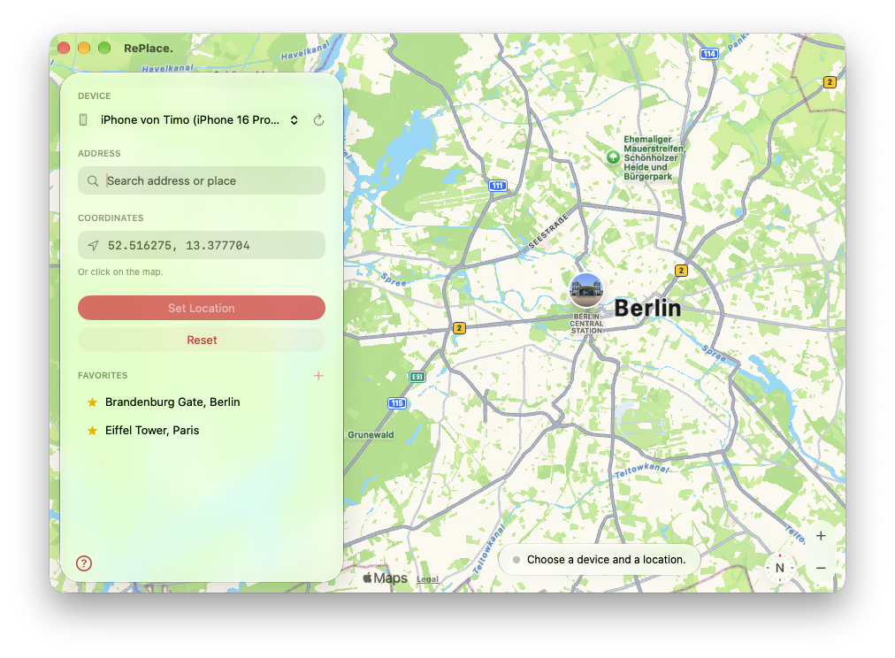

  <picture>
    <source media="(prefers-color-scheme: dark)" srcset="docs/icon-dark.png">
    
  </picture>

# RePlace.

A small macOS app that sets a simulated GPS location on your iPhone – pick a place on the map, search an address or paste coordinates, and press **Set Location**. It works for the whole device, so every app sees the simulated location.

The app is available in English and German.

  

## How it works

RePlace. is a thin SwiftUI front end for Apple's own `xcrun devicectl device simulate location` command (the same mechanism Xcode uses for "Simulate Location"). It does not jailbreak or modify the iPhone, and it needs no third-party tools.

## Requirements

- macOS 27 and Xcode (including its command line tools) installed
- An iPhone connected by cable or Wi-Fi, unlocked and paired with the Mac
- **Developer Mode** enabled on the iPhone (Settings → Privacy & Security → Developer Mode)

## Build and run

1. Open `RePlace.xcodeproj` in Xcode.
2. Select the `RePlace` scheme and **My Mac** as the destination.
3. Press ⌘R. The project is signed locally ("Sign to Run Locally"), so no Apple Developer account is needed.

If you want to ship your own build, change the bundle identifier (`de.timoschroeder.RePlace`) and set your own signing team.

## Usage

1. Choose your iPhone in the sidebar.
2. Click the map, search an address or enter `latitude, longitude`.
3. Press **Set Location**.
4. Press **Reset** to return to the real location. The simulation also ends when the connection to the Mac is lost.

Favorites are stored locally in the app's preferences on your Mac.

## Privacy

RePlace. does not collect, store or send any personal data to the developer. It has no accounts, analytics, advertising or tracking, and it never reads your real location.

- **Map and address search:** The map tiles and the address search are provided by Apple Maps (MapKit). When you search, your search text is sent to Apple and handled under [Apple's privacy policy](https://www.apple.com/legal/privacy/).
- **Your iPhone:** The coordinates you choose are sent only to the iPhone you select, through Apple's own `devicectl` tool on your Mac.
- **Stored on your Mac:** Your favorites are saved locally in the app's preferences and are never uploaded. Delete the app's preferences to remove them.

## Responsible use

Use RePlace. only on your own devices, for development, testing and privacy purposes. Many apps and online services forbid faking your location in their terms of use and may suspend accounts that do so. You are responsible for how you use this tool. The software is provided as is, without warranty (see [LICENSE](LICENSE)).

## License

MIT – see [LICENSE](LICENSE).
